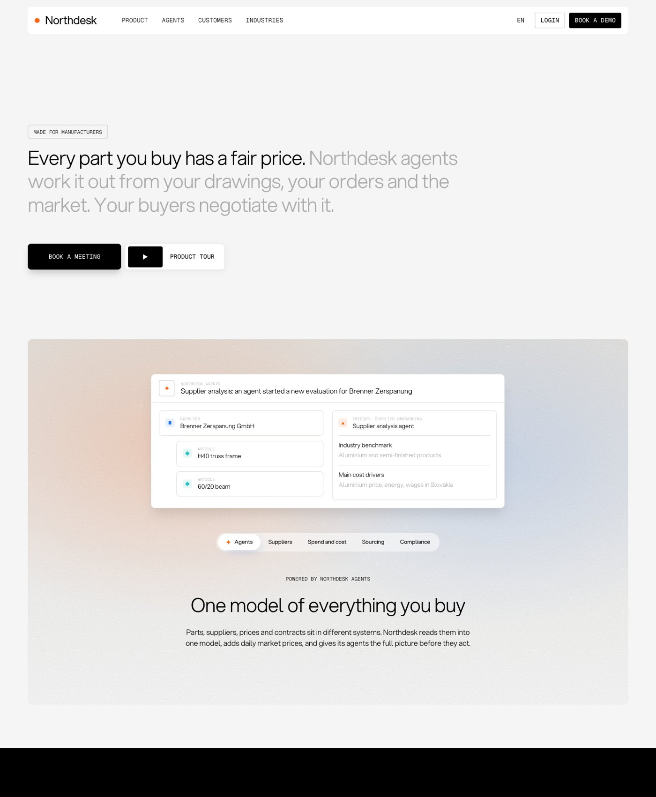
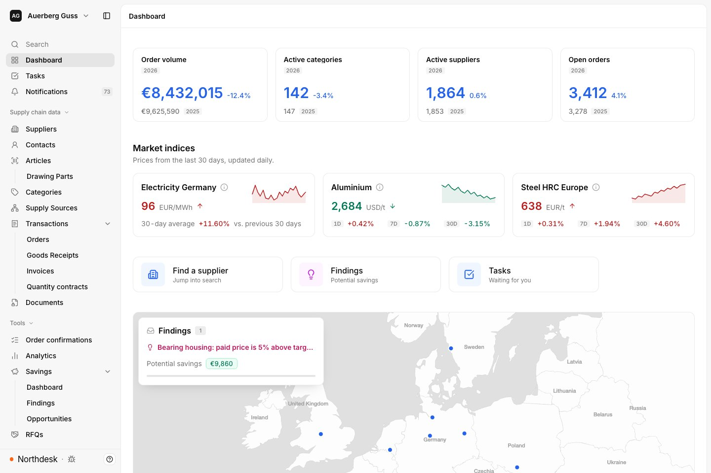
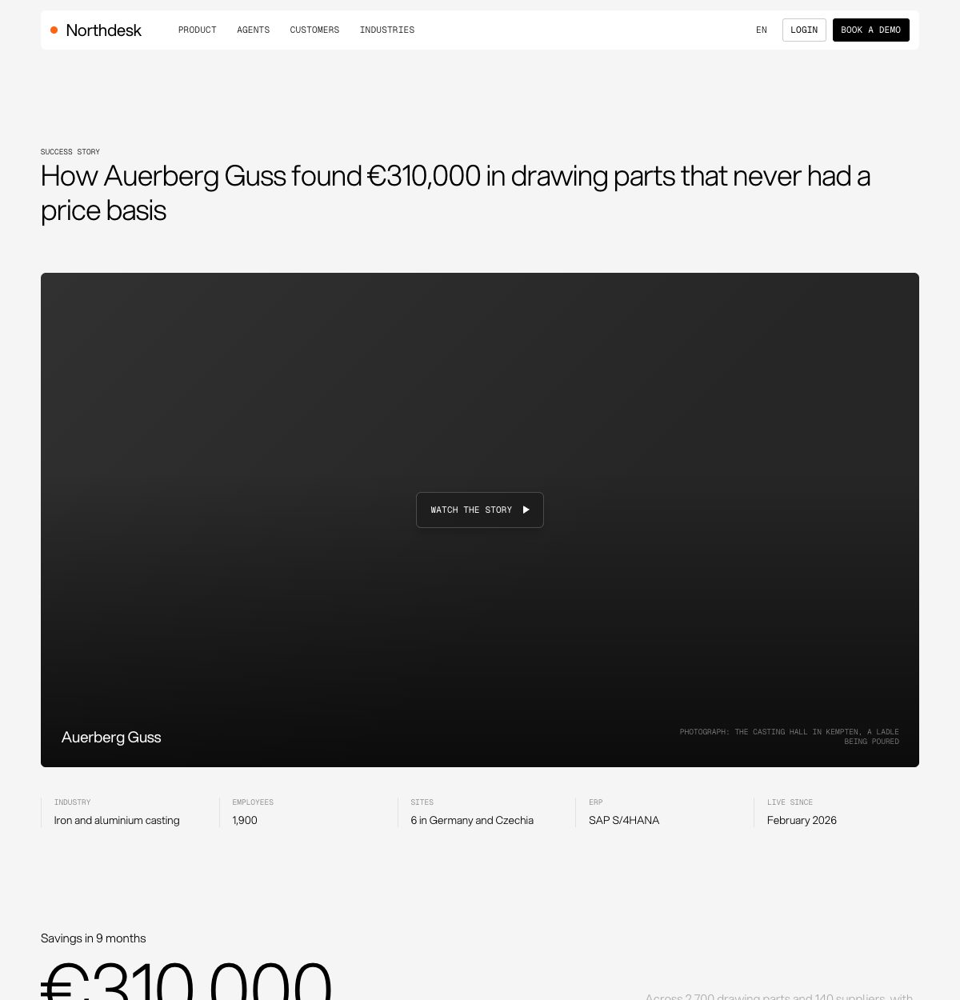
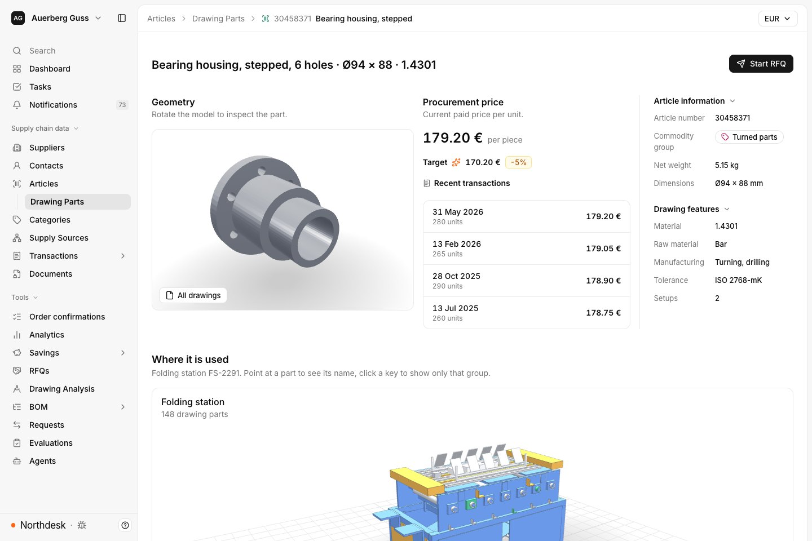
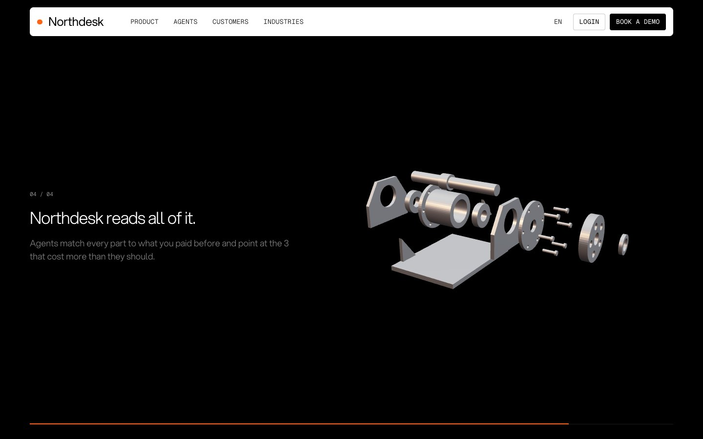
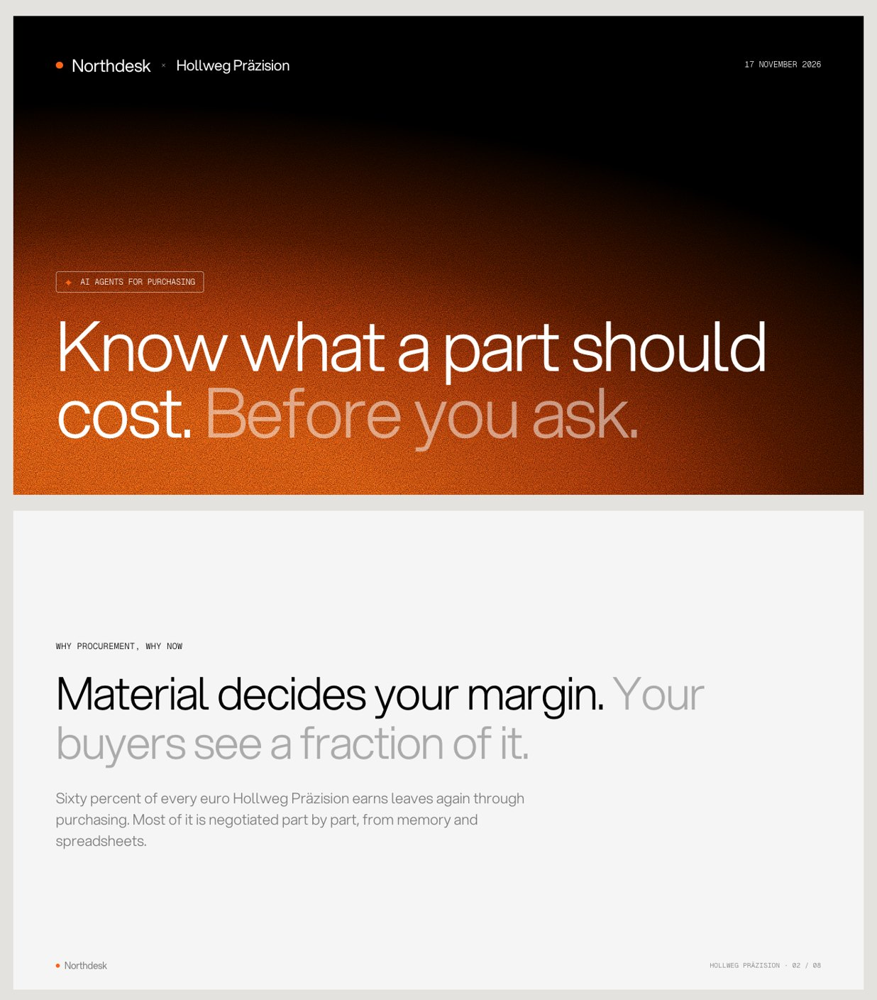
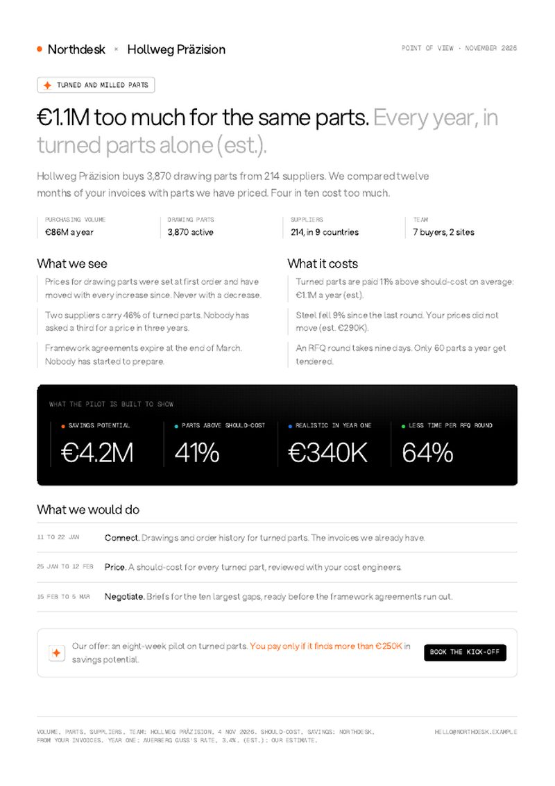
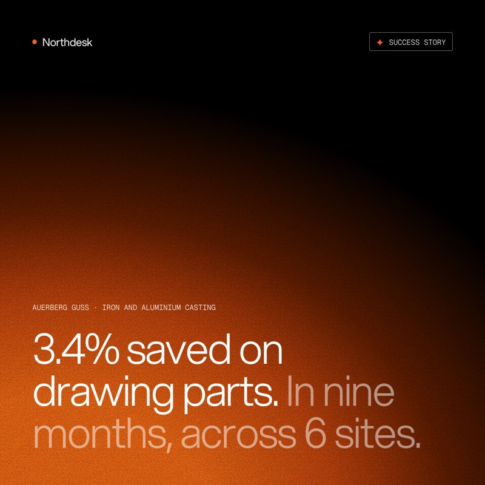

# tacto-design

A Claude skill that makes whatever Claude produces look and read like [Tacto](https://www.tacto.ai): the light typography, mono labels, black and orange, grainy ember panels, tall cards, huge numbers, product UI, motion and writing voice. Landing pages, dashboards, success stories, customer POVs, decks, articles, posts and their images.

Unofficial. Not affiliated with or endorsed by Tacto. See [Disclaimer](#disclaimer).



| Dashboard | Success story |
|---|---|
|  |  |

| Part in 3D with its exploded assembly | A page that tells a story with scroll |
|---|---|
|  |  |

| Deck | Customer POV | Cover |
|---|---|---|
|  |  |  |

## Install

**Claude Code** (all projects):

```bash
git clone https://github.com/henrywang-12/tacto-design ~/.claude/skills/tacto-design
```

**One project only:**

```bash
git clone https://github.com/henrywang-12/tacto-design .claude/skills/tacto-design
```

**With the skills CLI:**

```bash
npx skills add henrywang-12/tacto-design
```

**Claude apps (claude.ai, desktop):** download this repo as a ZIP and upload it under Settings > Capabilities > Skills.

To update later: `git -C ~/.claude/skills/tacto-design pull`.

## Use

Ask for anything and say you want the Tacto look:

- "Build a control tower dashboard for our purchasing team, Tacto style."
- "One-page customer POV for tomorrow's call with a pump manufacturer, on-brand."
- "Turn this pilot result into a LinkedIn post with its image, like Tacto would."
- "Seven-slide deck for their CPO in the Tacto design language."
- "Restyle this page with the tacto-design skill and tell me what was off."

Or invoke it directly in Claude Code with `/tacto-design`.

## What is inside

```
SKILL.md                    the rules that carry the likeness, the workflow, the checklist
assets/tacto.css            every token and component (drop-in stylesheet)
assets/tacto.js             reveal on scroll, count-up numbers, tabs, rail arrows
assets/fonts/               Aspekta and Geist Mono (SIL Open Font License)
assets/templates/           landing · scroll-story · dashboard · dashboard-detail · dashboard-article · case-study · pov · deck · article · cover · cover-landscape
assets/tacto-scroll.js · assets/tacto-3d.js   scroll scenes and the 3D part viewer (three.js r128 in assets/vendor/)
assets/icons/ · assets/maps/  Lucide icons and map outlines for the product screen
references/foundations.md   the artboard, colour, type scale, spacing, radius, elevation
references/components.md    anatomy and measurements of each component
references/imagery.md       ember, veil and noir panels, fragments, photography, line drawings, charts
references/dashboard.md     the product screen, measured from Tacto's product film
references/3d.md            3D parts: one look, drag and throw, exploded view
references/motion.md        what moves, how far, how long
references/voice.md         how the copy is written, English and German
references/formats.md       recipe per deliverable; PPTX, DOCX, email and image translations
references/cobranding.md    your logo and the customer's: finding it, sizes, where each goes
scripts/shoot.sh            render HTML to PNG or PDF with headless Chrome
scripts/tacto_check.py      the check before delivery: opens the file in a browser and fails on cut-off pages
                            and slides, off-system fonts, weights and colours, emoji and advert words, missing logos
scripts/tacto_lint.py       the source-only part of that check
scripts/inline.py           one self-contained HTML file: CSS, fonts, JS, your logo and local images embedded
scripts/logo.py             find a customer's logo (saved files, your own source, their website)
scripts/panel.py            generate an ember, noir or veil background as a PNG
```

The scripts need Python 3 (standard library only). `tacto_check.py` and `shoot.sh` need Chrome, Chromium or Edge; PDF page previews need `pdftoppm` (poppler).

You can also use the stylesheet without Claude:

```html
<link rel="stylesheet" href="assets/tacto.css">
<script src="assets/tacto.js" defer></script>
```

```bash
python3 scripts/tacto_check.py your-page.html
```

## Your own brand and your customers' logos

The templates use a fictional company. To make everything come out as *your* company, add a private folder next to `SKILL.md`. It is git-ignored and never published:

```
brand.local/
  brand.json     {"name": "Your Company", "logo": "logo.svg", "logo_white": "logo-white.svg"}
  brand.md       notes for Claude: spelling of the name, product words, contact line
  logo.svg       dark logo        logo-white.svg   white logo
  customers/     saved customer logos
```

`scripts/inline.py` then replaces every wordmark with your real logo (dark or white, chosen by the background), and `scripts/logo.py "Customer" customer.com` fetches a customer's logo so a POV, deck or dashboard made for them shows both: `you × them`. Rules for sizes and placement: `references/cobranding.md`.

## The design language in ten lines

1. One sans typeface, Aspekta, always **light** (300). Numerals 200. Never bold.
2. Every label is Geist Mono in small capitals, often with a 5px dot or an orange spark.
3. Headlines are short sentences with full stops; the second half is dimmed to grey.
4. Pure black, white, a light grey page `#F5F5F5`, and one orange `#FF6414`.
5. Anything image-like sits on an ember panel: black burning into grainy orange.
6. Tall white cards with one hairline: chip top left, words bottom left, empty in between.
7. Rectangles: 4px on buttons and chips, 8px on cards. Black buttons that turn orange.
8. Numbers are huge, light and plain, with a dot and a mono label.
9. Motion is a slow 0.6s rise and fade, once.
10. The copy is certain and industrial, with a customer and a number beside each claim. No exclamation marks, no emoji.

## How it was made, and how accurate it is

The values were read from the live site in November 2026: computed styles, the stylesheet, section structure and about 6,500 words of copy in English and German. Then rebuilt from scratch as an original stylesheet and templates, rendered, and compared against the site.

- **Typefaces.** Tacto uses Aspekta and Geist Mono. Both are open source (SIL Open Font License) and are included with their licences, so the type matches exactly.
- **Measured:** web pages, success stories, articles, the product fragments shown on the site.
- **Reconstructed:** the ember, veil and noir panels. On the site they are images; here they are CSS gradients with generated grain that match them closely, not pixel for pixel.
- **Measured from the product film:** the product screen (sidebar, icons, KPI and index cards, tables, charts). Hex values are matched to the nearest palette step, because video blurs colour.
- **Derived:** slide decks, A4 pages, emails and office documents. These apply the same tokens to a new canvas.
- **Not included:** Tacto's photographs, illustrations, logo and copy. The brand leans on industrial photography; the templates mark where a photograph belongs.
- **Social posts:** not accessible, so the post rules follow the article voice.
- A website changes. If theirs does, this will drift; pull requests with new measurements are welcome.

## Disclaimer

This is an independent study of a public website's design language, made for learning and for producing your own on-brand work. It is not affiliated with, sponsored by or endorsed by Tacto (Tacto Technology GmbH). "Tacto" and its logo are trademarks of their owner.

The repository contains no Tacto logo, image or illustration. The templates use a fictional company (Northdesk), fictional customers and original text; every figure, name and quote in them is invented. The voice guide quotes a handful of two- or three-word phrases from the site to show a pattern, and nothing longer; the four-point spark is this project's own drawing of a common sparkle shape. Do not use this skill to pass anything off as an official Tacto communication, and do not present invented customers, testimonials or figures as real.

If you represent Tacto and want something changed or removed, open an issue.

## License

MIT for the code, stylesheet, templates and documentation in this repository. The fonts in `assets/fonts/` are under the SIL Open Font License 1.1 (see the licence files beside them). See [LICENSE](LICENSE).
